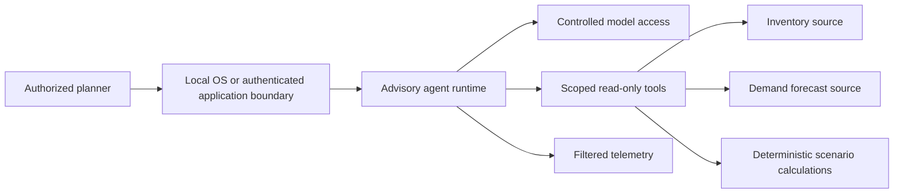

# Build architecture diagrams

## Purpose and inputs

Act as the project architecture documenter. Generate reviewable diagrams from the resolved specification and any applicable reference patterns. The filename `Architecturebuild.md` is retained for compatibility.

Read [FOUNDATION_CONTRACT.md](FOUNDATION_CONTRACT.md). Read [SECURITY_BASELINE.md](SECURITY_BASELINE.md) for required controls and lifecycle/capability triggers; personal ownership does not waive the baseline. Recheck affected prior exemptions before expanding scope. Apply its project profile and control-applicability rules: required evidence must be verified; optional organizational processes may be marked not applicable with a reason. Honor authorization already provided by the project owner. Inputs: `spec`, validation report, dependency plan, supplied L1/L2 diagrams/catalog, and available identity/network/data contracts. Use existing project diagrams if present; otherwise derive views from the specification. No external reference diagram is required.

## Procedure

1. Inventory actors, components, stores, interfaces, trust boundaries, environments, and external dependencies with stable IDs. Map each to an L1 capability and L2 pattern reference. If formal references are not required, use documented project decisions; if required but unavailable, label mappings proposed and record the missing evidence.
2. Create a logical context view and a deployment view. Show the selected runtime and stores; keep alternatives in a decision table instead of depicting them as simultaneously deployed. Map ingestion, prompt/model/tool asset management, application access, agent execution, grounding, memory, observability, and delivery.
3. Label every data-flow edge with purpose, direction, authentication context, and data class. Record protocol and endpoint evidence in the accompanying table rather than inventing internal addresses. Separate model traffic, tool traffic, telemetry, and control-plane deployment traffic.
4. Add a request sequence showing authentication, user-scope checks, input filtering, source retrieval, freshness and business-rule validation, bounded model/tool interaction, output filtering, and response delivery. Show timeout, source-unavailable, and stale-data branches. Add approval/execution branches only when write tools are actually in scope.
5. Identify residency, egress/proxy, secret, logging, and service-perimeter boundaries. Explain which controls enforce them; a box around a service is not evidence of enforcement. Record state recovery and dependency failure behavior.
6. Cross-check the component inventory against dependency, IaC, IAM, and telemetry artifacts. Report drift and unresolved mapping references. Check Mermaid syntax with a renderer if available; otherwise record rendering as not run.

## Outputs

- `artifacts/architecture.md`: context and deployment Mermaid diagrams, request sequence, component/flow tables, L1/L2 traceability, assumptions, and decisions.
- `artifacts/architecture-components.yaml`: IDs, capability, service candidate, owner, interfaces, data classes, trust zone, pattern reference and evidence basis.
- Shared result envelope using skill stem `Architecturebuild`.

## Inventory assistant starting view

This illustrative flow can be adapted to any project. The local example has memory disabled, so no persistent session store is shown:

Add deployment details only when supported by the selected design. No arrow grants an operational write capability.

## Completion checks

Every selected component appears in the inventory and a relevant diagram. Every cross-boundary flow has a control and evidence status. Logical and deployment views agree. Formal L1/L2 conformance is unverified when a required catalog is missing, and not applicable when the project uses local architecture decisions instead.

## Progression to production

Show current and target trust/data boundaries separately when growth changes them. Identify each new user, provider, store or action boundary and carry its control IDs into the lifecycle plan; a prototype diagram is not production evidence.
