<div align="center">

# LeadFlow AI

**Turns a fictional auto-insurance inquiry into a stored, scored and enriched lead with an email
draft a person can approve, running on your own machine.**

Fictional leads · Firestore Emulator · Public vehicle and ZIP data · No AI model or paid API



</div>

## Start

Windows PowerShell, from the repository root. The bootstrap downloads only checksum-verified Java,
Firestore Emulator and Structurizr artifacts into the ignored `.tools/` folder.

```powershell
powershell -NoProfile -ExecutionPolicy Bypass -File .\scripts\bootstrap-phase1-tools.ps1
. .\scripts\activate-toolchain.ps1
pnpm install --frozen-lockfile
pnpm check
```

`pnpm check` is the offline gate: formatting, lint, strict TypeScript, tests, builds, the fixed
evaluation cases, local smoke tests, diagram and docs checks, governance and OpenSpec validation. It
needs no credentials and makes no outside calls.

To use the app, run each line in its own activated PowerShell window, waiting for each to report
that it is ready:

```powershell
pnpm emulator:start
pnpm build; pnpm api:local -- --enrichment=recorded
pnpm seed:local
pnpm --filter @leadflow-ai/web exec vite
```

Open the URL Vite prints. It opens on the LeadFlow AI cover; `#intake` takes a new fictional lead,
`#runs` shows leads and the approval queue, and `#metrics` shows the dashboard. The seed adds 40 fictional leads that use saved
responses. Run `pnpm api:local` without `--enrichment` to look up the real public sources for leads
you enter. Stopping the emulator discards all state.

## How it works


1. An operator enters a fictional inquiry. The API saves the lead and its run in one Firestore
   transaction before any work starts
   ([sequence](docs/diagrams/persist-before-processing.svg)).
2. A fixed LangGraph.js workflow scores marketing readiness with a fixed 100-point rubric. The
   score measures how ready the lead is for follow-up, never insurance eligibility or price.
3. It checks the vehicle against NHTSA's public vehicle database and looks up the ZIP Code. Each
   answer is stored with its source, time and a fingerprint, labelled live, recorded or mock. A
   source that does not answer is shown as unavailable, never as a "no".
4. If the lead agreed to be contacted, it writes an email draft from a fixed template. Every
   sentence comes from the inquiry, from a verified answer, or from fixed wording.
5. Eight checks run before a draft reaches a person: sources are complete, claims are verified,
   consent is recorded, there is no pricing or eligibility language, and none of the lead's own
   free text is copied in.

## Human review



A draft that passes waits in the approval queue. The operator can approve it, reject it or edit
it. An edit becomes a new version that is checked again. An approval applies to that exact text
and means the draft may be copied or exported for manual use. LeadFlow has no way to send email,
and a governance check fails the build if one appears. The stored records are in the
[data model](docs/diagrams/data-model.svg) and the
[enrichment and review records](docs/diagrams/data-model-outreach.svg).

## Recovery



Every step is saved as it happens. A temporary fault gets one retry, and a run that still fails can
be resumed by the operator. A run stopped by a crash can be picked up again once its lease expires,
and lookups that were in flight are repeated. Failures stay visible rather than turning into
success.

## Dashboard

The metrics view shows lead volume, priority mix, processing time, lookup success, failed runs and
the approval queue. Each figure is calculated from stored runs and states what it counts and what it
leaves out. Live and saved lookups are never added together, and the synthetic simulator's
outcomes appear only in their own labelled panel. Every chart also has a table of its values.

## Evidence

<!-- bottom-line:start -->
- 51 fixed synthetic evaluation cases
- rubric-v1 weights: need timeline 40, request clarity 30, completeness 30
<!-- bottom-line:end -->

Results are tied to a system bundle that records the code, lockfile, cases and tool versions. Cases
that need a hosted model, the live sources, cloud Firestore, real personal data or production are
reported as `not_run`, never as passes. The live lookups were checked once with an authorized
probe, and their saved responses are what the offline tests use. See [AI_OPS.md](AI_OPS.md).

## Limits

- This is a local prototype. Nothing is deployed and there is no sign-in yet.
- Every lead, contact and outcome is fictional. The only intake field verified against the public
  Military.com page is ZIP Code
  ([source record](docs/research/military-com-intake-2026-10-24.md)), and form parity is
  unconfirmed.
- AI models, authentication, cloud storage and any sending of messages stay behind the gates in
  [PROJECT.md](PROJECT.md).

## Commands

| Command | What it does |
|---|---|
| `pnpm check` | Full offline gate |
| `pnpm emulator:start` | Temporary Firestore Emulator on `127.0.0.1:8080` |
| `pnpm api:local` | Serve the API with live lookups; add `-- --enrichment=recorded` for saved responses |
| `pnpm seed:local` | Add 40 fictional leads through the API (saved responses only) |
| `pnpm enrichment:probe` | Owner-authorized live lookup that refreshes the saved responses |
| `pnpm emulator:runtime` | End-to-end test of the API and workflow against the emulator |
| `pnpm eval` | Run the fixed evaluation cases (after `pnpm build`) |
| `pnpm docs:diagrams` | Regenerate the diagrams and README assets |
| `pnpm audit:dependencies` | Registry audit (network; never applies fixes) |

## Documents

| Document | Contents |
|---|---|
| [PROJECT.md](PROJECT.md) | Scope, decisions, roadmap and operator gates |
| [docs/development.md](docs/development.md) | Toolchain, local session and shell workarounds |
| [docs/architecture/workspace.dsl](docs/architecture/workspace.dsl) | Structurizr model behind the diagrams |
| [docs/dependencies/phase-2.md](docs/dependencies/phase-2.md) | Phase 2 dependencies, licences and limits |
| [WORKFLOW.md](WORKFLOW.md) | Phase, review and verification workflow |

## Licence and credits

Released under the [MIT License](LICENSE). Vehicle data comes from NHTSA's
vPIC API, and ZIP data comes from Zippopotam.us, which uses GeoNames data. Diagrams are drawn with
the MIT-licensed [diagram-design](.agents/skills/diagram-design/SKILL.md) skill. Dependencies and
their licences are listed in [docs/dependencies/phase-1.md](docs/dependencies/phase-1.md) and
[docs/dependencies/phase-2.md](docs/dependencies/phase-2.md).

LeadFlow AI is an independent portfolio prototype. It is not affiliated with or endorsed by
Military.com, NHTSA or any insurer.
