<div align="center">

# LeadFlow AI

**Lead qualification and outreach drafting for fictional auto-insurance inquiries.**

Fictional leads · Firestore Emulator · Public vehicle and ZIP data · Optional Claude agent team

</div>

## Start

Clone the public repository, then enter it:

```console
git clone https://github.com/prentopoulos/leadflow-ai.git
cd leadflow-ai
```

On macOS (Apple Silicon or Intel), use the project-local Bash toolchain:

```bash
bash ./scripts/bootstrap-phase1-tools.sh
source ./scripts/activate-toolchain.sh
pnpm install --frozen-lockfile
pnpm check
```

On Windows, use PowerShell:

```powershell
powershell -NoProfile -ExecutionPolicy Bypass -File .\scripts\bootstrap-phase1-tools.ps1
. .\scripts\activate-toolchain.ps1
pnpm install --frozen-lockfile
pnpm check
```

Both bootstraps install the verified project toolchain inside `.tools/`; no system-wide Node or Java
installation is required. `pnpm check` runs the complete credential-free offline gate.

### Run the demo

In an activated shell (above), one command starts everything with saved responses:

```console
pnpm demo
```

Open the printed link and press **Run simulated traffic**. Sixty fictional leads arrive from
simulated channels while the dashboard updates. Press Ctrl+C to stop; nothing is kept.

Add `-- --open` to open a browser. Add `-- --agents` to enable the paid Claude research team, capped
at $0.30 per lead and $8 per session.

## How it works



1. Save the fictional lead before processing.
2. Score marketing readiness with a fixed 100-point rubric.
3. Verify the vehicle and ZIP Code against public sources.
4. Draft only when contact consent is recorded.
5. Check every claim before placing the draft in the approval queue.

The score is for marketing follow-up, never eligibility, underwriting, risk or price. Missing
evidence stays visibly unavailable.

## Technical system



React calls a loopback Fastify API. The API stores the run in Firestore, executes the fixed
LangGraph workflow and records every step. Recorded NHTSA and Zippopotam.us responses keep the demo
and quality gate offline.

## Optional research team



With `--agents`, one research lead coordinates three specialists: vehicle, area and requested
coverage. Code checks their citations before one short paragraph is added to the template.

The team receives no name, email, ZIP Code or free-text message. Failed evidence, model errors or a
spend cap leave the plain template draft. The hosted demo never enables this team.

## Human review

A passing draft waits for an operator to approve, reject or edit it. Edited text is checked again.
Approval permits manual copy or export only; LeadFlow cannot send email.

## Recovery

Every step is stored. Temporary faults get one retry; interrupted and failed runs remain visible
and can be resumed by the operator.

## Security

<p align="center">
  
</p>

No current role combines untrusted input, real personal data and outbound or state-changing access.
Local enrichment and research use approved read-only public sources; neither receives real personal
data. Insurer connections, quotes and automatic sending do not exist.

## Private hosted demo

The private Cloud Run demo is restricted by Google sign-in and a one-account allowlist. It uses
recorded lookups, stores data for at most seven days and never runs the optional research team.

Runs execute only while a request is open. Timed-out work stays stored for operator resume. See the
[runbook](docs/operations/runbook.md) and [deployment evidence](docs/evidence/phase-3/index.json).

## Dashboard

The dashboard derives lead volume, priority, timing, lookup success, failures and review status from
stored runs. Synthetic acquisition stays in a separately labelled panel, and every chart has a data
table.

### Simulated acquisition

Simulated channels, campaigns, click IDs and spend demonstrate cost per lead and channel mix. They
do not use Google Ads or Analytics data and do not claim that one channel performs better.

## Evidence

<!-- bottom-line:start -->
- 90 fixed synthetic evaluation cases
- rubric-v1 weights: need timeline 40, request clarity 30, completeness 30
<!-- bottom-line:end -->

Each result records the code, lockfile, cases and tool versions. Agent cases use a scripted model to
test controls, not prose quality. Anything requiring a live model, source or deployment is reported
as `not_run`, never as a pass. See [AI_OPS.md](AI_OPS.md).

## Limits

- Prototype only; the hosted demo is private, single-user and has no availability promise.
- Every lead, contact and outcome is fictional.
- LeadFlow implements only a verified subset of the public Military.com form; it does not claim
  parity ([source record](docs/research/military-com-intake-2026-10-26.md)).
- Real personal data, hosted model calls, cloud live lookups and message sending remain gated in
  [PROJECT.md](PROJECT.md).

## Commands

| Command | What it does |
|---|---|
| `pnpm check` | Full offline gate |
| `pnpm emulator:start` | Temporary Firestore Emulator on `127.0.0.1:8080` |
| `pnpm api:local` | Serve the API with live lookups; add `-- --enrichment=recorded` for saved responses or `-- --agents=claude` for the agent team |
| `pnpm demo` | Start the emulator, API and web app for a live demo; add `-- --agents` for the paid Claude agent team |
| `pnpm simulate:traffic` | Send 60 fictional leads with simulated attribution through the API, one every 10 s (saved responses only) |
| `pnpm enrichment:probe` | Owner-authorized live lookup that refreshes the saved responses |
| `pnpm emulator:runtime` | End-to-end test of the API and workflow against the emulator |
| `pnpm eval` | Run the fixed evaluation cases (after `pnpm build`) |
| `pnpm docs:diagrams` | Regenerate the four documentation diagrams |
| `pnpm audit:dependencies` | Registry audit (network; never applies fixes) |

## Documents

| Document | Contents |
|---|---|
| [PROJECT.md](PROJECT.md) | Scope, decisions, roadmap and operator gates |
| [docs/development.md](docs/development.md) | Toolchain, local session and shell workarounds |
| [docs/architecture/workspace.dsl](docs/architecture/workspace.dsl) | Structurizr model behind the diagrams |
| [docs/dependencies/phase-2.md](docs/dependencies/phase-2.md) | Phase 2 dependencies, licences and limits |
| [docs/dependencies/phase-3.md](docs/dependencies/phase-3.md) | Phase 3 container base and IAP verification library |
| [docs/dependencies/phase-5.md](docs/dependencies/phase-5.md) | Phase 5 Anthropic SDK, models, prices and spend limits |
| [docs/operations/runbook.md](docs/operations/runbook.md) | Hosted setup, release, smoke, rollback, purge and teardown |
| [docs/evidence/phase-3/index.json](docs/evidence/phase-3/index.json) | Deployment evidence, with checks not yet run marked `not_run` |
| [docs/evidence/phase-4/index.json](docs/evidence/phase-4/index.json) | Phase 4 hosted demonstration evidence; every check `not_run` until the approved run |
| [docs/walkthrough.md](docs/walkthrough.md) | Timed script for the two-minute captioned walkthrough |
| [WORKFLOW.md](WORKFLOW.md) | Phase, review and verification workflow |

## Licence and credits

Released under the [MIT License](LICENSE). Vehicle data comes from NHTSA's
vPIC API, and ZIP data comes from Zippopotam.us, which uses GeoNames data. The optional agent team
uses Anthropic's Claude API. Diagrams are drawn with
the MIT-licensed [diagram-design](.agents/skills/diagram-design/SKILL.md) skill. Dependencies and
their licences are listed in [docs/dependencies/phase-1.md](docs/dependencies/phase-1.md),
[docs/dependencies/phase-2.md](docs/dependencies/phase-2.md),
[docs/dependencies/phase-3.md](docs/dependencies/phase-3.md) and
[docs/dependencies/phase-5.md](docs/dependencies/phase-5.md).

LeadFlow AI is an independent portfolio prototype. It is not affiliated with or endorsed by
Military.com, NHTSA, Google, Anthropic or any insurer.
